# Prestashop-Cesar-Blanco-Salguero

## Introducción

Nuestro objetivo es implantar la aplicación Web Prestashop en una pila LAMP en **Debian**, usando ``phpMyAdmin`` y un certificado HTTPS de **Let's Encrypt**, automatizando el proceso con scripts de bash. Lo haremos usando **Vagrant** y **VirtualBox**


## 1. Infraestructura del entorno

Para hacer esta práctica crearemos una VM que tendrá todo lo que se necesita para ejecutar la tienda:

| Elemento | Valor | Función |
| :--- | :--- | :--- |
| Hipervisor | VirtualBox | Ejecuta la máquina virtual |
| Orquestación | Vagrant | Crea y aprovisiona la VM a partir del `Vagrantfile` |
| Sistema operativo | Debian 12 (Bookworm) | Base del servidor |
| Recursos | 2 GB de RAM y 2 CPU | Mínimo para ejecutar PrestaShop |
| Dirección IP | `192.168.56.10` | IP fija de la VM en la red privada |
| Dominio | `<subdominio>.duckdns.org` | Nombre con el que se accede a la tienda |
| Certificado | Let's Encrypt (desafío DNS-01) | Cifrado HTTPS |
| Pila de software | Apache, MariaDB, PHP y phpMyAdmin | Servidor web, base de datos y gestión de la BD |
| Aplicación | PrestaShop | Tienda online |

## 2. Despliegue de la máquina con Vagrant

Creamos un `Vagrantfile` para crear la VM llamada `CesarBlancoPrestashop`, con Debian, 2 GB de RAM y una IP fija. Lo generamos con el comando:

```pwsh
vagrant init bento/debian-12
```

Y lo dejamos con esta configuración:

````ruby
# -*- mode: ruby -*-
# vi: set ft=ruby :

# Quita los saltos de línea de Windows (\r) de los scripts antes de ejecutarlos
LIMPIAR_CRLF = "find /vagrant/scripts /vagrant/conf -type f \\( -name '*.sh' -o -name '*.conf' -o -name '.env' \\) -exec sed -i 's/\\r$//' {} + 2>/dev/null || true"

Vagrant.configure("2") do |config|
  config.vm.box = "bento/debian-12"

  config.vm.define "CesarBlancoPrestashop" do |ps|
    ps.vm.hostname = "CesarBlancoPrestashop"
    ps.vm.network "private_network", ip: "192.168.56.10"

    ps.vm.provider "virtualbox" do |vb|
      vb.name = "CesarBlancoPrestashop"
      vb.memory = 2048
      vb.cpus = 2
    end

    # Los tres scripts de aprovisionamiento solo se ejecutan cuando se piden por nombre
    ps.vm.provision "lamp", type: "shell", run: "never",
      inline: "#{LIMPIAR_CRLF} && bash /vagrant/scripts/install_lamp.sh"

    ps.vm.provision "https", type: "shell", run: "never",
      env: { "DUCKDNS_TOKEN" => ENV.fetch("DUCKDNS_TOKEN", "") },
      inline: "#{LIMPIAR_CRLF} && bash /vagrant/scripts/setup_letsencrypt_https.sh"

    ps.vm.provision "prestashop", type: "shell", run: "never",
      inline: "#{LIMPIAR_CRLF} && bash /vagrant/scripts/deploy_prestashop.sh"
  end
end

````

### Explicación de la configuración del Vagrantfile

* `LIMPIAR_CRLF`: variable con un comando que convierte los saltos de línea de Windows (`\r\n`) de los scripts, el `.env` y los `.conf` en saltos de línea de Linux (`\n`). Así evitamos que Bash falle al ejecutar archivos creados en Windows.
* `config.vm.box = "bento/debian-12"`: imagen base, Debian 12 (Bookworm).
* `config.vm.define "CesarBlancoPrestashop"`: crea la VM que tendrá toda la aplicación.
* `ps.vm.hostname`: nombre de host de la máquina.
* `ps.vm.network "private_network", ip: "192.168.56.10"`: IP fija de la VM, accesible desde el anfitrión.
* `vb.name`: nombre de la VM en VirtualBox.
* `vb.memory = 2048` y `vb.cpus = 2`: recursos que le otorgamos a la VM.
* `ps.vm.provision "lamp"`, `"https"` y `"prestashop"`: los tres aprovisionadores que ejecutan los scripts de Bash. Cada uno limpia antes los saltos de línea con `LIMPIAR_CRLF` y lanza su script desde la carpeta compartida `/vagrant`.
* `run: "never"`: evita que se ejecuten con un `vagrant up` normal. Solo funcionan cuando los pedimos por su nombre con `vagrant provision --provision-with <nombre>`.
* `env: { "DUCKDNS_TOKEN" => ENV.fetch("DUCKDNS_TOKEN", "") }`: pasa el token de DuckDNS desde una variable de entorno del anfitrión al script de HTTPS, para que no se guarde en el repositorio.

Iniciamos la VM sin aprovisionar para comprobar que la configuración es correcta:

````pwsh
vagrant up --no-provision
````

Y vemos su estado con:

````pwsh
vagrant status
````

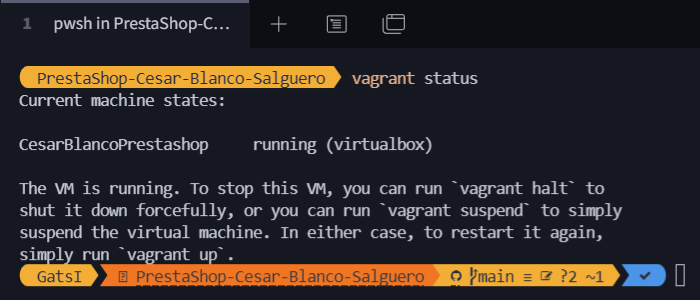

__Captura de pantalla donde se puede ver el estado de la VM__

## 3. Instalación de la pila LAMP

Toda la configuración de esta parte se guarda en la carpeta `scripts`, que Vagrant comparte con la VM en `/vagrant`.

### 3.1 Variables de configuración

Creamos el archivo `scripts/.env` con los valores que usarán los scripts: dominio, nombre de la base de datos, usuario y límites de PHP. Por practicas de seguridad y privacidad no guardamos aquí las contraseñas, y solo los tendremos con un texto de ejemplo:

````bash
# Dominio de DuckDNS (sin .duckdns.org)
DUCKDNS_SUBDOMAIN="cesarblanco"
DOMINIO="${DUCKDNS_SUBDOMAIN}.duckdns.org"

# Base de datos de PrestaShop
DB_NAME="prestashop_db"
DB_USER="ps_usuario"
DB_PASS="CAMBIAR_en_env_local"

# phpMyAdmin
PMA_APP_PASS="CAMBIAR_en_env_local"

# PHP (valores que exige PrestaShop)
PHP_MEMORY_LIMIT="512M"
PHP_MAX_INPUT_VARS="5000"
PHP_POST_MAX_SIZE="64M"
PHP_UPLOAD_MAX_FILESIZE="64M"
PS_ZONA_HORARIA="Europe/Madrid"
````

Las contraseñas reales las tengo guardadas en `scripts/.env.local`, el cual es un archivo que excluimos del repo con `.gitignore`:

````
.env.local
.vagrant/
````

__Explicación:__ los scripts cargan primero `.env` y después `.env.local`, así las claves reales sobrescriben los textos de ejemplo. Así el repo no guarda ninguna contraseña. Si una clave sigue siendo un texto de ejemplo, el script se detiene con un error.

### 3.2 Configuración del sitio de Apache

Creamos el archivo `conf/000-default.conf` con el VirtualHost del puerto 80:

````apache
<VirtualHost *:80>
    ServerName __DOMINIO__
    DocumentRoot /var/www/html

    <Directory /var/www/html>
        AllowOverride All
        Require all granted
    </Directory>

    ErrorLog ${APACHE_LOG_DIR}/ps-http-error.log
    CustomLog ${APACHE_LOG_DIR}/ps-http-access.log combined
</VirtualHost>
````

__Explicación:__
* `ServerName __DOMINIO__`: Texto que el script sustituirá con el dominio de DuckDNS.
* `DocumentRoot /var/www/html`: carpeta donde se instalará PrestaShop.
* `AllowOverride All`: permite usar el `.htaccess` de PrestaShop, necesario para las URL amigables.
* `ErrorLog` y `CustomLog`: archivos de registro propios de este sitio.

### 3.3 Script de instalación `install_lamp.sh`

Creamos el script `scripts/install_lamp.sh`:

````bash
#!/bin/bash
# Instala la pila LAMP (Apache, MariaDB, PHP) y phpMyAdmin en Debian 12
set -euo pipefail

DIR="$(cd "$(dirname "${BASH_SOURCE[0]}")" && pwd)"
RAIZ_REPO="$(dirname "$DIR")"

cargar_env() {
  set -a
  source <(sed 's/\r$//' "$1")
  set +a
}

cargar_env "$DIR/.env"
if [[ -f "$DIR/.env.local" ]]; then
  cargar_env "$DIR/.env.local"
fi

for var in DB_PASS PMA_APP_PASS; do
  if [[ "${!var}" == CAMBIAR* ]]; then
    echo "ERROR: define ${var} en scripts/.env.local" >&2
    exit 1
  fi
done

export DEBIAN_FRONTEND=noninteractive

echo "[1/7] Actualizando paquetes"
apt-get update -qq

echo "[2/7] Instalando Apache, MariaDB y PHP"
apt-get install -y -qq apache2 mariadb-server php libapache2-mod-php php-cli \
  php-mysql php-curl php-gd php-intl php-mbstring php-xml php-zip php-bcmath \
  unzip curl openssl ca-certificates

echo "[3/7] Configurando PHP para PrestaShop"
PHP_VER="$(php -r 'echo PHP_MAJOR_VERSION.".".PHP_MINOR_VERSION;')"
for sapi in apache2 cli; do
  cat > "/etc/php/${PHP_VER}/${sapi}/conf.d/99-prestashop.ini" <<EOF
memory_limit = ${PHP_MEMORY_LIMIT}
max_input_vars = ${PHP_MAX_INPUT_VARS}
post_max_size = ${PHP_POST_MAX_SIZE}
upload_max_filesize = ${PHP_UPLOAD_MAX_FILESIZE}
date.timezone = ${PS_ZONA_HORARIA}
EOF
done

echo "[4/7] Creando la base de datos y el usuario"
mysql <<EOF
CREATE DATABASE IF NOT EXISTS \`${DB_NAME}\` CHARACTER SET utf8mb4 COLLATE utf8mb4_unicode_ci;
CREATE USER IF NOT EXISTS '${DB_USER}'@'localhost' IDENTIFIED BY '${DB_PASS}';
ALTER USER '${DB_USER}'@'localhost' IDENTIFIED BY '${DB_PASS}';
GRANT ALL PRIVILEGES ON \`${DB_NAME}\`.* TO '${DB_USER}'@'localhost';
FLUSH PRIVILEGES;
EOF

echo "[5/7] Instalando phpMyAdmin"
echo "phpmyadmin phpmyadmin/dbconfig-install boolean true" | debconf-set-selections
echo "phpmyadmin phpmyadmin/app-password-confirm password ${PMA_APP_PASS}" | debconf-set-selections
echo "phpmyadmin phpmyadmin/mysql/app-pass password ${PMA_APP_PASS}" | debconf-set-selections
echo "phpmyadmin phpmyadmin/reconfigure-webserver multiselect apache2" | debconf-set-selections
apt-get install -y -qq phpmyadmin

echo "[6/7] Configurando Apache"
a2enmod rewrite ssl headers >/dev/null
echo "ServerName ${DOMINIO}" > /etc/apache2/conf-available/servername.conf
a2enconf servername >/dev/null
sed "s/__DOMINIO__/${DOMINIO}/g" "$RAIZ_REPO/conf/000-default.conf" \
  > /etc/apache2/sites-available/000-default.conf
apache2ctl configtest
systemctl restart apache2

echo "[7/7] Comprobación final"
systemctl is-active apache2 mariadb
php -v | head -n 1
echo "LAMP instalada correctamente"
````


__Explicación:__
* Carga `.env` y `.env.local`, y se detiene si faltan las contraseñas reales.
* Instala Apache, MariaDB, PHP y las extensiones que necesita PrestaShop.
* Crea `99-prestashop.ini` con los límites de PHP que exige PrestaShop.
* Crea la base de datos y un usuario con permisos solo sobre ella.
* Instala phpMyAdmin sin preguntas, usando `debconf-set-selections`.
* Activa los módulos `rewrite`, `ssl` y `headers`, aplica el VirtualHost y reinicia Apache.

### 3.4 Ejecución del script

Ejecutamos el aprovisionador `lamp` con el comando:

````pwsh
vagrant provision --provision-with lamp
````

__Explicación:__ Vagrant ejecuta en la VM el script `install_lamp.sh`. Cuando acaba muestra: `LAMP instalada correctamente`.

### 3.5 Comprobación de los servicios

Comprobamos que Apache y MariaDB están activos y la versión de PHP instalada con el comando:

````pwsh
vagrant ssh -c "sudo systemctl status apache2 mariadb --no-pager; php -v"
````

__Explicación:__ `systemctl status` muestra el estado de los servicios y `php -v` la versión de PHP. Ambos servicios aparecen como `active (running)`.

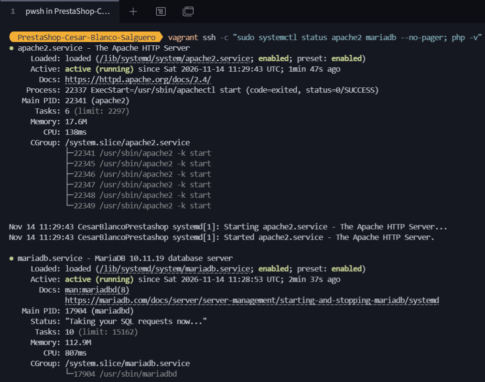

__Captura de pantalla donde se puede ver que Apache y MariaDB están activos y la versión de PHP__

### 3.6 Comprobación de la base de datos

Comprobamos que el script ha creado la base de datos de PrestaShop con el comando:

````bash
sudo mysql -e "SHOW DATABASES;"
````

Comprobamos que existe el usuario de la base de datos con el comando:

````bash
sudo mysql -e "SELECT user, host FROM mysql.user WHERE user='ps_usuario';"
````

Y comprobamos sus permisos con el comando:

````bash
sudo mysql -e "SELECT User, Host, Db, Select_priv, Insert_priv, Update_priv, Delete_priv FROM mysql.db WHERE User='ps_usuario';"
````

__Explicación:__
* `SHOW DATABASES`: lista las bases de datos y en ella aparece `prestashop_db`.
* `mysql.user`: muestra que el usuario `ps_usuario` solo puede conectarse desde `localhost`.
* `mysql.db`: muestra que el usuario tiene permisos únicamente sobre `prestashop_db`.

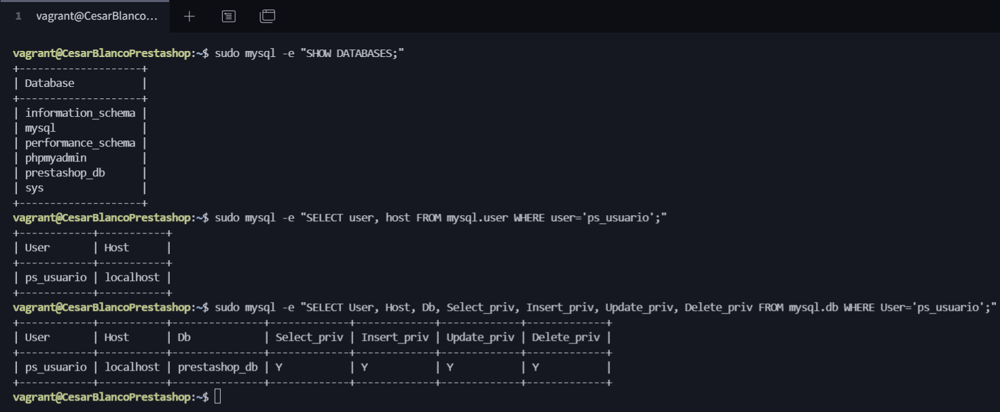

__Captura de pantalla donde se puede ver la base de datos, el usuario y sus permisos__

## 4. Dominio con DuckDNS

Usamos [DuckDNS](https://www.duckdns.org) haciendo que la IP apunte a la IP privada de la VM, `192.168.56.10`. Así se puede acceder a la tienda con un nombre de dominio y el nombre nos sirve para pedir el certificado Let's Encrypt.

En la página de DuckDNS configuramos la IP del subdominio `cesarblanco` con el valor `192.168.56.10`.

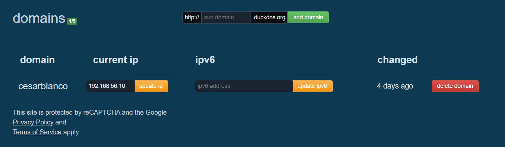

__Captura de pantalla donde se puede ver el subdominio de DuckDNS apuntando a la IP de la VM__

Comprobamos desde el equipo anfitrión que el dominio nos da la IP de la VM con el comando:

```pwsh
nslookup cesarblanco.duckdns.org
```

__Explicación:__ `nslookup` consulta al servidor DNS la IP asociada al nombre. La respuesta es `192.168.56.10`, la IP privada de la VM.

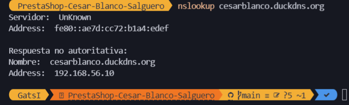

__Captura de pantalla donde se puede ver que el dominio resuelve a la IP de la VM__

## 5. Certificado HTTPS con Let's Encrypt

### 5.1 Variables del certificado

Añadimos a ``scripts/.env`` el correo y un indicador para poder elegir entre el servidor de pruebas y el real:

````bash
LE_EMAIL="CAMBIAR_en_env_local"
LE_STAGING="false"
````

En `scripts/.env.local` ponemos el correo real y `LE_STAGING="true"`, para probar primero sin gastar los límites de Let's Encrypt.

El token de DuckDNS lo ponemos en nuestra terminal como una variable de entorno del equipo anfitrión, y el `Vagrantfile` se lo pasa al script:

````pwsh
$env:DUCKDNS_TOKEN = "<token>"
````

### 5.2 Script `setup_letsencrypt_https.sh`

Creamos el script `scripts/setup_letsencrypt_https.sh`:

````bash
#!/bin/bash
# Pide un certificado de Let's Encrypt con el desafío DNS-01 de DuckDNS
set -euo pipefail

DIR="$(cd "$(dirname "${BASH_SOURCE[0]}")" && pwd)"
RAIZ_REPO="$(dirname "$DIR")"

cargar_env() {
  set -a
  source <(sed 's/\r$//' "$1")
  set +a
}

cargar_env "$DIR/.env"
if [[ -f "$DIR/.env.local" ]]; then
  cargar_env "$DIR/.env.local"
fi

if [[ -z "${DUCKDNS_TOKEN:-}" ]]; then
  echo "ERROR: falta la variable DUCKDNS_TOKEN en el equipo anfitrión" >&2
  exit 1
fi
if [[ "${LE_EMAIL}" == CAMBIAR* ]]; then
  echo "ERROR: define LE_EMAIL en scripts/.env.local" >&2
  exit 1
fi

export DEBIAN_FRONTEND=noninteractive
CARPETA_HOOKS="/etc/letsencrypt/duckdns"

echo "[1/4] Instalando certbot"
apt-get update -qq
apt-get install -y -qq certbot

echo "[2/4] Guardando el token para las renovaciones"
install -d -m 700 "$CARPETA_HOOKS"
printf 'DUCKDNS_TOKEN=%s\n' "$DUCKDNS_TOKEN" > "$CARPETA_HOOKS/duckdns.env"
chmod 600 "$CARPETA_HOOKS/duckdns.env"

echo "[3/4] Creando los scripts del desafío DNS-01"
cat > "$CARPETA_HOOKS/auth-hook.sh" <<'EOF'
#!/bin/bash
# Crea el registro TXT _acme-challenge en DuckDNS
source /etc/letsencrypt/duckdns/duckdns.env
SUB="${CERTBOT_DOMAIN%.duckdns.org}"
RESPUESTA="$(curl -s "https://www.duckdns.org/update?domains=${SUB}&token=${DUCKDNS_TOKEN}&txt=${CERTBOT_VALIDATION}")"
if [[ "$RESPUESTA" != "OK" ]]; then
  echo "DuckDNS no aceptó el registro TXT" >&2
  exit 1
fi
sleep 30
EOF

cat > "$CARPETA_HOOKS/cleanup-hook.sh" <<'EOF'
#!/bin/bash
# Borra el registro TXT cuando termina la validación
source /etc/letsencrypt/duckdns/duckdns.env
SUB="${CERTBOT_DOMAIN%.duckdns.org}"
curl -s "https://www.duckdns.org/update?domains=${SUB}&token=${DUCKDNS_TOKEN}&txt=borrar&clear=true" > /dev/null
EOF

install -d /etc/letsencrypt/renewal-hooks/deploy
cat > /etc/letsencrypt/renewal-hooks/deploy/recargar-apache.sh <<'EOF'
#!/bin/bash
systemctl reload apache2 || true
EOF
chmod 700 "$CARPETA_HOOKS/auth-hook.sh" "$CARPETA_HOOKS/cleanup-hook.sh"
chmod 755 /etc/letsencrypt/renewal-hooks/deploy/recargar-apache.sh

echo "[4/4] Pidiendo el certificado para ${DOMINIO}"
OPCION_STAGING=()
if [[ "${LE_STAGING}" == "true" ]]; then
  OPCION_STAGING=(--staging)
  echo "Modo de PRUEBA (staging): el certificado no será de confianza"
fi

# Si pasamos de staging a real, eliminamos el certificado de prueba
RENOVACION="/etc/letsencrypt/renewal/${DOMINIO}.conf"
if [[ "${LE_STAGING}" != "true" && -f "$RENOVACION" ]] && grep -q "staging" "$RENOVACION"; then
  certbot delete --cert-name "$DOMINIO" --non-interactive
fi

certbot certonly --manual --preferred-challenges dns \
  --manual-auth-hook "$CARPETA_HOOKS/auth-hook.sh" \
  --manual-cleanup-hook "$CARPETA_HOOKS/cleanup-hook.sh" \
  -d "$DOMINIO" --cert-name "$DOMINIO" \
  --email "$LE_EMAIL" --agree-tos --no-eff-email \
  --non-interactive --keep-until-expiring \
  "${OPCION_STAGING[@]}"

echo "Certificado obtenido correctamente"
````

__Explicación:__
* Comprueba que tenemos el token de DuckDNS y el correo antes de empezar.
* Instala `certbot`.
* Guarda el token dentro de la VM, en un archivo que solo puede leer el administrador, para que el certificado se pueda renovar solo.
* Crea dos pequeños scripts que hacen la comprobación del dominio: uno crea un registro en DuckDNS para demostrar que el dominio es nuestro y el otro lo borra al terminar.
* Crea otro script que recarga Apache cuando el certificado se renueva.
* Pide el certificado. Si `LE_STAGING` vale `true`, lo pide al servidor de pruebas.

### 5.3 Prueba con el servidor de pruebas (staging)

Ejecutamos el aprovisionador `https`:

````pwsh
vagrant provision --provision-with https
````

Comprobamos el certificado obtenido dentro de la VM:

````bash
sudo certbot certificates
````

__Explicación:__ el certificado aparece como ``TEST_CERT`` porque viene del servidor de pruebas. Con esto verificamos que el desafío DNS-01 funciona antes de pedir el certificado real.

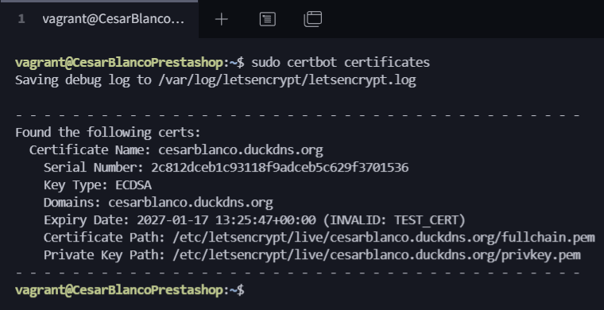

__Captura de pantalla donde se puede ver el certificado de pruebas obtenido para el dominio__

### 5.4 Certificado real

Despues de comprobar que funciona, quitamos de ``scripts/.env.local`` la línea ``LE_STAGING="true"`` y ponemos ``LE_STAGING="false"``. Al cambiar esto ahora el script pide el certificado real, así que volvemos a ejecutar el aprovisionador:

````pwsh
vagrant provision --provision-with https
````

__Explicación:__ el script detecta que existe el certificado de pruebas, lo elimina y pide el real a Let's Encrypt.

Y ahora comprobamos el certificado dentro de la VM:

````bash
sudo certbot certificates
````

__Explicación:__ ahora el certificado aparece como `VALID` y con 89 días de validez, sin la marca `TEST_CERT`.

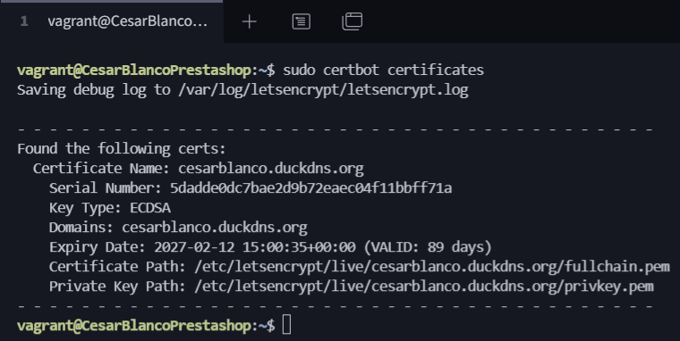

__Captura de pantalla donde se puede ver el certificado real de Let's Encrypt para el dominio__

## 6. Configuración de HTTPS en Apache

Con el certificado ya conseguido, configuramos Apache para que lo use.

### 6.1 VirtualHost HTTPS

Creamos el archivo `conf/default-ssl.conf` con el VirtualHost del puerto 443:

````apache
<VirtualHost *:443>
    ServerName __DOMINIO__
    DocumentRoot /var/www/html

    SSLEngine on
    SSLCertificateFile /etc/letsencrypt/live/__DOMINIO__/fullchain.pem
    SSLCertificateKeyFile /etc/letsencrypt/live/__DOMINIO__/privkey.pem

    <Directory /var/www/html>
        AllowOverride All
        Require all granted
    </Directory>

    ErrorLog ${APACHE_LOG_DIR}/ps-ssl-error.log
    CustomLog ${APACHE_LOG_DIR}/ps-ssl-access.log combined
</VirtualHost>
````

__Explicación:__
* `<VirtualHost *:443>`: atiende las conexiones HTTPS, que usan el puerto 443.
* `SSLEngine on`: activa el cifrado.
* `SSLCertificateFile` y `SSLCertificateKeyFile`: indican dónde están el certificado y su clave privada, que creó Certbot.
* `__DOMINIO__`: marcador que el script cambia por nuestro dominio.

### 6.2 Redirección de HTTP a HTTPS

Añadimos a `conf/000-default.conf`, justo debajo de `ServerName`, la línea:

````apache
Redirect permanent / https://__DOMINIO__/
````

__Explicación:__ todo el que entre por `http://` lo enviamos a `https://`, así hacemos que la tienda siempre se use cifrada.

### 6.3 Activación en el script

Añadimos al final de `scripts/setup_letsencrypt_https.sh` un último paso:

````bash
echo "[5/5] Activando HTTPS en Apache"
a2enmod ssl headers rewrite > /dev/null
sed "s/__DOMINIO__/${DOMINIO}/g" "$RAIZ_REPO/conf/000-default.conf" \
  > /etc/apache2/sites-available/000-default.conf
sed "s/__DOMINIO__/${DOMINIO}/g" "$RAIZ_REPO/conf/default-ssl.conf" \
  > /etc/apache2/sites-available/default-ssl.conf
a2ensite default-ssl > /dev/null
apache2ctl configtest
systemctl restart apache2
echo "HTTPS activado en https://${DOMINIO}"
````

__Explicación:__
* Copia los dos VirtualHost a Apache, cambiando `__DOMINIO__` por nuestro dominio.
* Activa el sitio HTTPS con `a2ensite`.
* Comprueba la configuración con `apache2ctl configtest` y reinicia Apache.

Volvemos a ejecutar el aprovisionador:

````pwsh
vagrant provision --provision-with https
````

__Explicación:__ Como el certificado existe y es valido Certbot ya no pide otro y solo aplica la configuración de Apache.

### 6.4 Comprobación en el navegador

Abrimos `http://cesarblanco.duckdns.org` en el navegador. Nos redirige a `https://` y muestra el candado, sin avisos, porque el certificado es válido.

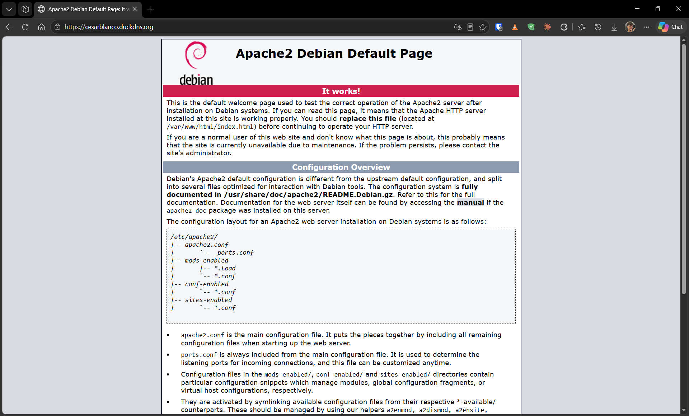

__Captura de pantalla donde se puede ver la página en HTTPS con el candado y sin avisos de seguridad__

### 6.5 Comprobación de phpMyAdmin

Entramos phpMyAdmin con `https://cesarblanco.duckdns.org/phpmyadmin`. Iniciamos sesión con el usuario de la base de datos que creamos, `ps_usuario`, y vemos que tiene acceso a la base de datos `prestashop_db`.

__Explicación:__ phpMyAdmin es una web para gestionar la base de datos sin usar comandos. Usamos el usuario `ps_usuario` en lugar del administrador porque solo tiene permisos sobre la base de datos de la tienda.

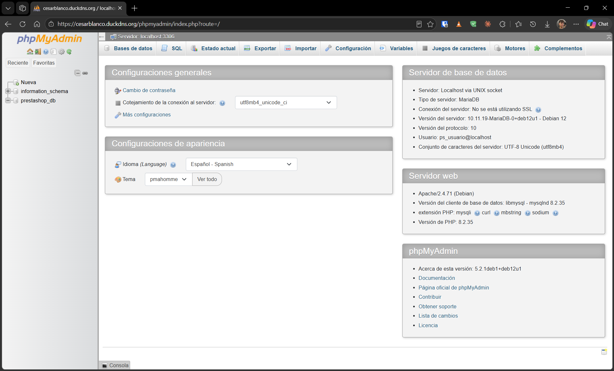

__Captura de pantalla donde se puede ver phpMyAdmin en HTTPS con la base de datos de PrestaShop__

## 7. Despliegue de PrestaShop

### 7.1 Variables de PrestaShop

Añadimos a `scripts/.env` los datos de la tienda y la versión que vamos a instalar:

````bash
# PrestaShop
PS_NOMBRE_TIENDA="Tienda Cesar Blanco"
PS_NOMBRE_ADMIN="Cesar"
PS_APELLIDOS_ADMIN="Blanco"
PS_ADMIN_EMAIL="CAMBIAR_en_env_local"
PS_ADMIN_PASS="CAMBIAR_en_env_local"
PS_PAIS="es"
PS_IDIOMA="es"
PS_VERSION="9.0.0-1.0"
````

El correo y la contraseña del administrador los dejamos con un texto de ejemplo, y los datos reales van en `scripts/.env.local`.

__Explicación:__
* `PS_VERSION`: versión de PrestaShop que se descarga. Fijarla hace que se despliegue siempre igual.
* `PS_NOMBRE_TIENDA`, `PS_NOMBRE_ADMIN` y `PS_APELLIDOS_ADMIN`: datos de la tienda y del administrador.
* `PS_PAIS` y `PS_IDIOMA`: tienda en español para España.
* `PS_CARPETA_ADMIN`: nuevo nombre para la carpeta del panel de administración, por seguridad.

### 7.2 Script `deploy_prestashop.sh`

Creamos el script `scripts/deploy_prestashop.sh`, que descarga y prepara PrestaShop:

````bash
#!/bin/bash
# Descarga y despliega PrestaShop en Apache
set -euo pipefail

DIR="$(cd "$(dirname "${BASH_SOURCE[0]}")" && pwd)"
RAIZ_REPO="$(dirname "$DIR")"

cargar_env() {
  set -a
  source <(sed 's/\r$//' "$1")
  set +a
}

cargar_env "$DIR/.env"
if [[ -f "$DIR/.env.local" ]]; then
  cargar_env "$DIR/.env.local"
fi

for var in DB_PASS PS_ADMIN_EMAIL PS_ADMIN_PASS; do
  if [[ "${!var}" == CAMBIAR* ]]; then
    echo "ERROR: define ${var} en scripts/.env.local" >&2
    exit 1
  fi
done

RAIZ_WEB="/var/www/html"
TEMPORAL="$(mktemp -d)"

echo "[1/4] Descargando PrestaShop ${PS_VERSION}"
curl -fL -o "$TEMPORAL/prestashop.zip" \
  "https://assets.prestashop3.com/dst/edition/corporate/${PS_VERSION}/prestashop_edition_classic_version_${PS_VERSION}.zip?source=vagrant"

echo "[2/4] Descomprimiendo en ${RAIZ_WEB}"
unzip -q "$TEMPORAL/prestashop.zip" -d "$TEMPORAL/paquete"
rm -f "$RAIZ_WEB/index.html"
unzip -q -o "$TEMPORAL/paquete/prestashop.zip" -d "$RAIZ_WEB"

echo "[3/4] Ajustando permisos"
chown -R www-data:www-data "$RAIZ_WEB"
rm -rf "$TEMPORAL"

echo "PrestaShop descomprimido en ${RAIZ_WEB}"


echo "[4/4] Instalando PhpPsInfo (comprobación de requisitos)"
curl -fsSL -o "$RAIZ_WEB/phppsinfo.php" \
  https://raw.githubusercontent.com/PrestaShop/php-ps-info/master/phppsinfo.php
sed -i "s/const DEFAULT_LOGIN = '[^']*';/const DEFAULT_LOGIN = 'psinfo';/" "$RAIZ_WEB/phppsinfo.php"
sed -i "s/const DEFAULT_PASSWORD = '[^']*';/const DEFAULT_PASSWORD = '${PS_ADMIN_PASS}';/" "$RAIZ_WEB/phppsinfo.php"
chown www-data:www-data "$RAIZ_WEB/phppsinfo.php"
echo "PhpPsInfo disponible en https://${DOMINIO}/phppsinfo.php"
````

__Explicación:__
* Descarga PrestaShop desde la web oficial. Desde la versión 9 los archivos ya no se publican en GitHub, así que usamos el enlace directo para automatizar instalaciones de PrestaShop.
* El archivo que hemos descargado tiene dentro otro `prestashop.zip`, que es el que se descomprime en `/var/www/html`.
* Borra la página por defecto de Apache y da la propiedad de los archivos al usuario de Apache (`www-data`), para que PrestaShop pueda escribir en sus carpetas.

Ejecutamos el aprovisionador:

````pwsh
vagrant provision --provision-with prestashop
````

### 7.3 Comprobación de requisitos con PhpPsInfo

Antes de instalar, comprobamos que el servidor cumple los requisitos con **PhpPsInfo**, la herramienta oficial de PrestaShop. El propio script la descarga en `/var/www/html/phppsinfo.php` y le cambia el usuario y la contraseña por defecto con `sed`.

__Explicación:__ la documentación de PhpPsInfo indica que el usuario y la contraseña se pueden cambiar con las variables `PS_INFO_LOGIN` y `PS_INFO_PASSWORD`. Lo probamos con `SetEnv` de Apache, pero esta versión de la herramienta sobrescribe esos valores con los de fábrica, y seguía aceptando `prestashop` / `prestashop`. Por eso modificamos directamente las constantes `DEFAULT_LOGIN` y `DEFAULT_PASSWORD` del archivo.

Entramos en `https://cesarblanco.duckdns.org/phppsinfo.php` con el usuario `psinfo` y la contraseña del administrador.

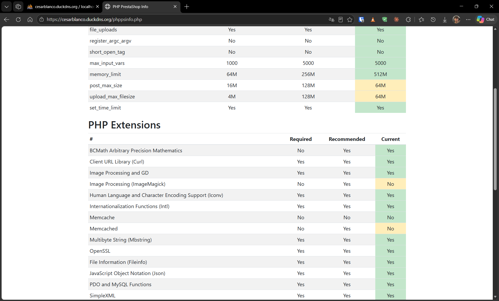

__Captura de pantalla donde se puede ver el resultado de la comprobación de requisitos (parte 1)__

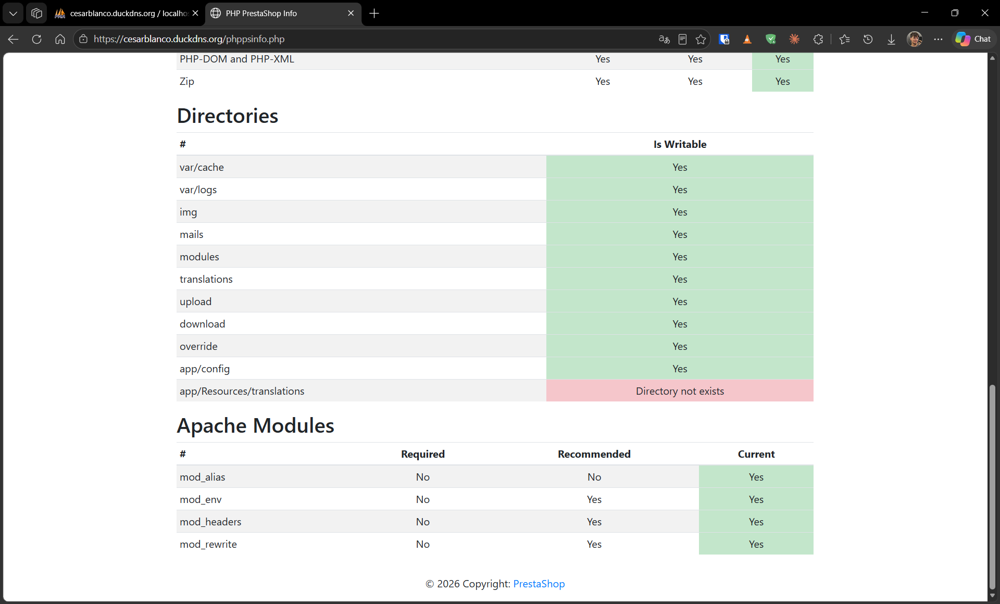

__Captura de pantalla donde se puede ver el resultado de la comprobación de requisitos (parte 2)__

Cumplimos todos los requisitos obligatorios. Quedan avisos en amarillo, que son solo recomendaciones: `post_max_size` y `upload_max_filesize` valían 64M cuando se recomiendan 128M, y faltan las extensiones opcionales ImageMagick y Memcached. La carpeta `app/Resources/translations` aparece como inexistente porque PrestaShop todavía no está instalado, y la crea durante la instalación.

### 7.4 Ajuste de los límites de subida

Subimos los dos límites a 128M cambiando estas variables en `scripts/.env`:

````bash
PHP_POST_MAX_SIZE="128M"
PHP_UPLOAD_MAX_FILESIZE="128M"
````

Y volvemos a ejecutar el aprovisionador de la pila LAMP:

````pwsh
vagrant provision --provision-with lamp
````

__Explicación:__ el script vuelve a escribir el archivo de configuración de PHP con los valores nuevos y reinicia Apache, sin tocar nada de lo ya instalado. Si una variable está también en `.env.local`, gana la de ese archivo, así que hay que cambiarla en los dos sitios.

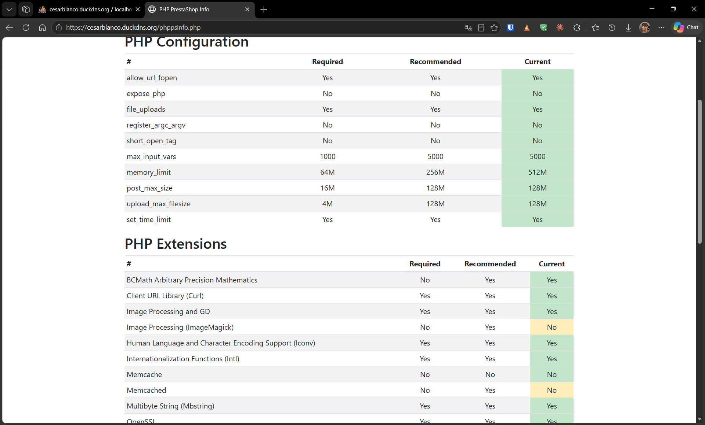

__Captura de pantalla donde se puede ver que los límites de subida ahora son de 128M__

### 7.5 Instalación de PrestaShop por línea de comandos

Ponemos al final del script `scripts/deploy_prestashop.sh` el paso que instala PrestaShop:

````bash
echo "[5/5] Instalando PrestaShop por línea de comandos"
cd "$RAIZ_WEB/install"
runuser -u www-data -- php index_cli.php \
  --domain="${DOMINIO}" \
  --ssl=1 \
  --db_server=localhost \
  --db_name="${DB_NAME}" \
  --db_user="${DB_USER}" \
  --db_password="${DB_PASS}" \
  --prefix=cb_ \
  --name="${PS_NOMBRE_TIENDA}" \
  --firstname="${PS_NOMBRE_ADMIN}" \
  --lastname="${PS_APELLIDOS_ADMIN}" \
  --email="${PS_ADMIN_EMAIL}" \
  --password="${PS_ADMIN_PASS}" \
  --country="${PS_PAIS}" \
  --language="${PS_IDIOMA}" \
  --timezone="${PS_ZONA_HORARIA}"
cd /
echo "PrestaShop instalado"
````

__Explicación:__
* `index_cli.php` es el instalador de PrestaShop en modo texto. Hace lo mismo que el asistente web, pero sin navegador, y por eso lo podemos automatizar.
* Se ejecuta como el usuario de Apache (`www-data`), para que los archivos que genera tengan el propietario correcto.
* `--domain` y `--ssl=1` configuran la tienda con nuestro dominio y con HTTPS.
* `--db_*` son los datos de la base de datos que creó el script de LAMP.
* `--prefix=cb_` cambia el prefijo de las tablas, ya que PrestaShop recomienda no usar el de por defecto.
* El resto de parámetros son el nombre de la tienda, los datos del administrador, el país, el idioma y la zona horaria.

Ejecutamos el aprovisionador:

```pwsh
vagrant provision --provision-with prestashop
```

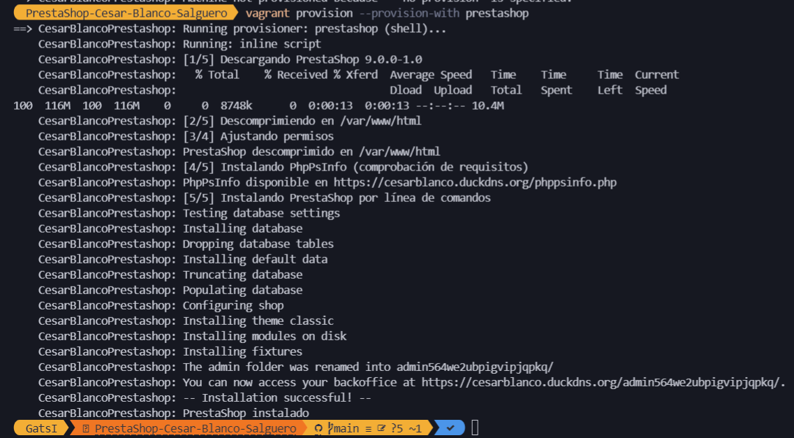

__Captura de pantalla donde se puede ver que la instalación de PrestaShop ha terminado correctamente__

### 7.6 Limpieza de seguridad

Cuando se haya instalado la tienda, borramos la carpeta `install` y la herramienta PhpPsInfo, que ya no las necesitamos:

````bash
sudo rm -rf /var/www/html/install /var/www/html/phppsinfo.php
````

Y añadimos el mismo paso al final de `scripts/deploy_prestashop.sh`, para que al desplegarlo de nuevo se haga solo:

````bash
echo "[6/6] Limpieza de seguridad"
rm -rf "$RAIZ_WEB/install"
rm -f "$RAIZ_WEB/phppsinfo.php"
echo "Carpeta install y PhpPsInfo eliminados"
````

__Explicación:__
* PrestaShop no nos deja usar la tienda mientras existe la carpeta `install`, y dejarla es un riesgo de seguridad.
* `phppsinfo.php` muestra datos del servidor, así que no tenemos que dejarlo en una tienda en funcionamiento.
* La carpeta del panel de administración no tenemos que renombrarla a mano, porque el instalador la renombra sola con un nombre aleatorio (`admin564we2ubpigvipjqpkq`), que es más seguro que elegirlo nosotros.

### 7.7 Comprobación de la tienda

Entramos a la tienda desde el navegador en `https://cesarblanco.duckdns.org`. Carga con el candado de HTTPS y sin ningún aviso, porque el certificado de Let's Encrypt es válido.

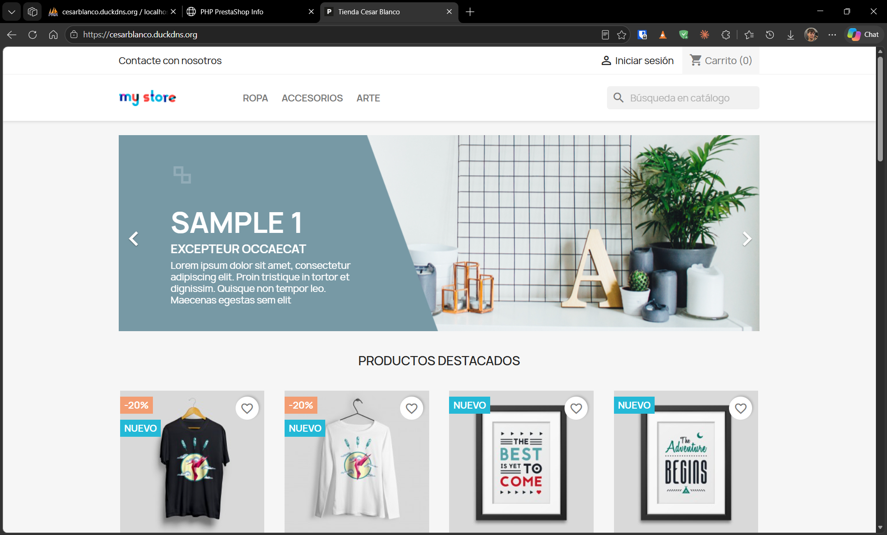

__Captura de pantalla donde se puede ver la tienda PrestaShop funcionando con HTTPS__

### 7.8 Acceso al panel de administración

Entramos al panel de administración con la dirección que mostró el instalador, usando el correo y la contraseña del administrador:

````
https://cesarblanco.duckdns.org/admin564we2ubpigvipjqpkq/
````

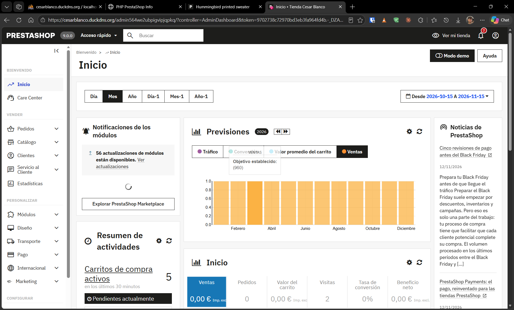

__Captura de pantalla donde se puede ver el panel de administración de PrestaShop__

## 8. Decisiones y diferencias respecto al enunciado

Estas son algunas diferencias respecto al enunciado:

| Lo que pide el enunciado | Lo que hemos hecho | Motivo |
| :--- | :--- | :--- |
| VM **Ubuntu** | VM **Debian 12** | Probé Ubuntu 24.04, pero la VM se quedaba congelada al arrancar |
| Variables en `scripts/.env` | `.env` con datos de ejemplo y `.env.local` con los datos reales | Para que las contraseñas no aparezcan en el repositorio |
| --- | El token de DuckDNS lo he pasado como variable para que no se guarde en ningún archivo del repo | Porque es un dato privado |
| `conf/000-default.conf` | Además `conf/default-ssl.conf` y una redirección de HTTP a HTTPS | Necesario para servir la tienda por HTTPS |
| --- | Opción `LE_STAGING` para usar el servidor de pruebas de Let's Encrypt | Para evitar agotar los límites del servidor mientras se prueba |
| --- | Scripts de renovación (`auth-hook`, `cleanup-hook`, recarga de Apache) | Con esto el certificado se renueva solo |
| Las credenciales de `phppsinfo.php` por defecto | Las cambiamos con `sed` y borramos la herramienta al terminar | Ya que dejarlas por defecto es un riesgo y la herramienta no debe estar en la tienda en funcionamiento |
| Arreglar los avisos de PhpPsInfo | Creamos `99-prestashop.ini` en el script de LAMP y subimos los límites de subida a 128M | PrestaShop pide esos valores |
| --- | Borramos la carpeta `install` al terminar | PrestaShop no funciona mientras existe esa carpeta, además de que es un riesgo de seguridad |
| --- | Los aprovisionadores solo se ejecutan por su nombre (`run: "never"`) y el `Vagrantfile` limpia los saltos de línea de Windows | Para controlar el orden en el que se ejecutan, y porque los archivos se crean en Windows |